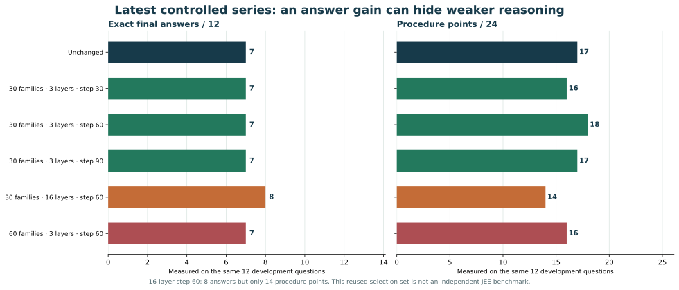

<h1 align="center">LlamaJEE.js</h1>

A browser-first JEE solver project by Om Patnaik, with a preserved record of its Qwen model experiments.

**Inspect five MLX LoRA adapters, their tradeoffs against the unchanged 9B base, and the gates that kept them experimental.**

[Original 9B lab setup](local_lab/README.md#run-it) · [Separate 0.8B browser demo](https://ompatnaik.com/llamajee/) · [Archived 9B adapters](https://huggingface.co/OmTheLast/jee-solver-experimental-mlx-adapters)

Apple Silicon + MLX for 9B inference. Browser preview runs a separate unchanged 0.8B model. Private questions and optimizer state are not published.

By Om Patnaik · repository created September 2026.

## Latest conversion milestone

[Actual 9B browser prototype and failed image checks](research/EXPORT09B02_BROWSER_PROTOTYPE.md): one trained checkpoint now completes a synthetic text question in Chrome, with exact CPU/browser token agreement. This prototype has not replaced the public 0.8B demo.

## Public browser deployment

The requested public address is [ompatnaik.com/llamajee/](https://ompatnaik.com/llamajee/). The current browser demo computes on the visitor’s device without an inference API. **The trained 9B browser export is still pending**; read the [dated deployment and export status](research/BROWSER_DEPLOYMENT_STATUS_2026_10_23.md). The local links below preserve the earlier development harness.

## Open the original 9B models

The original browser interface uses **browser → local Python server → MLX 9B model on your Mac**. The model runs on the Mac, while the browser displays its output.

| Installation | Browser link | Start it first |
| --- | --- | --- |
| Original development workspace, including its existing private attempt history | [Open original 9B lab](http://127.0.0.1:8765/) | From the JEE project root: `python3 src/jee/start_interactive_lab.py` |
| A clone of this public repository | [Open packaged 9B lab](http://127.0.0.1:8766/) | Follow [local setup](local_lab/README.md#run-it), then run `.venv/bin/python local_lab/start.py` |

Both interfaces offer the unchanged Qwen3.5-9B base and three experimental step-60 adapters: **30 families / 3 layers**, **30 families / 16 layers**, and **60 families / 3 layers**. Five adapter checkpoints are archived in this repository; three are selectable in the interface.

These `127.0.0.1` links connect to **the computer where you open them** and require its local server to be running. GitHub does not host a public 9B inference server. The [public Transformers.js demo](https://ompatnaik.com/llamajee/) runs the separate unchanged **0.8B ONNX** model inside the browser. Our original 9B lab uses **MLX weights and adapters**.

## Install

| Platform / path | Start here |
| --- | --- |
| Browser preview | [Try the unchanged 0.8B preview](https://ompatnaik.com/llamajee/) |
| Local 9B lab | Follow [local setup](local_lab/README.md) for the pinned base and compatible MLX stack |

Start with `history.csv` and the chart notes without downloading weights. To inspect a 9B adapter, use `load_mlx.py` after installing the compatible stack; it downloads the pinned base separately. None of the latest adapters was promoted as a better solver.

```bash
python -m compileall -q load_mlx.py conversion_lab  # inspect source without model downloads
```

## Why

You need to distinguish a higher answer count from a more reliable problem solver. These experiments preserve answer, procedure, and completion tradeoffs instead of selecting a checkpoint from one number. The reused 12-question development slice is too small for a broad JEE accuracy claim.

## Results



The base scores 7/12 strict answers and 17/24 procedure points; the wider-layer adapter reaches 8/12 answers but falls to 14/24 procedure points. None passes the latest promotion rule.

Rebuild with `python charts/make_charts.py`. [Raw history](history.csv) · [Chart notes](charts/README.md).

## Choose the correct runtime

The MLX adapters are project-specific artifacts rather than standalone or standard PEFT models. The local lab records private attempts; the WebGPU demo uses no 9B adapter weights.

## Inspect the next research gate

The 4B curriculum and repair reports are data milestones, not training gains. No 4B optimizer update has run in the recorded program; frozen no-regression, confirmation, and export-parity gates remain required. [Current research](research/TEACHING_REPAIR_COMPLETE_2026_10_19.md).

## Notes from building it

I kept procedure ratings and completion failures beside strict answers so a narrow gain could not hide regressions. The controlled comparisons led me to retain the unchanged base. I would require fresh confirmation and a reproducible export path before promoting another adapter.

## Commands

```bash
python load_mlx.py --adapter reliable01-step060 --question 'A particle starts from rest at 2 m/s^2 for 3 s. Find displacement.'  # inspect one adapter
python charts/make_charts.py      # rebuild source-labelled plots
python -m unittest discover -s local_lab -p 'test_*.py'  # check the local lab
```

## Verify it yourself

```bash
python -m unittest discover -s local_lab -p 'test_*.py'
python -m compileall -q load_mlx.py conversion_lab
```

Install the pinned `local_lab/requirements.txt` before running the lab tests; they require compatible MLX/MLX-VLM and Metal access. Lab checks do not establish answer correctness or adapter promotion; see `research/` for export limits and promotion gates. Syntax checks can run without downloading the model weights.

## Credits, license and pointers

Built on Qwen3.5-9B, its MLX community quantization, MLX/MLX-VLM, and Transformers.js for the separate preview. Research by Om Patnaik with recorded machine-review assistance. Apache-2.0 is declared in the original model metadata; see [the preserved model card](README-DETAILS.md) and upstream terms.

[Full setup, original notes, and project history](README-DETAILS.md).
