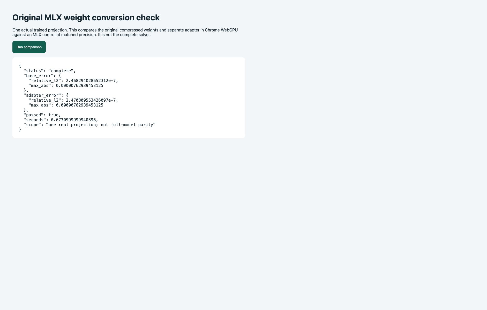

# Image conversion diagnosis and a more faithful export route

23 October 2026. Diagnostic round completed; full public 9B release remains incomplete. No training, paid service or model upload occurred.

## What was tested

Two generated 384 × 384 images: **2 + 3 = ?** (answer 5), and an independently drawn **8 − 1 = ?** (answer 7). The model prompt contains neither operands nor answers. Original image files, prepared arrays, model outputs, intermediate tensors and failures are preserved in the private evidence folder. The adapter is the existing, unselected Reliable01 step 60.

| Condition | 2 + 3 | 8 − 1 |
|---|---:|---:|
| Correct answer | 5 | 7 |
| Original BF16 base | 4 | 2 |
| Original BF16 + adapter | 4 | 2 |
| Original MLX base | 4 | 2 |
| Original MLX + adapter | 4 | 2 |
| BF16 + adapter, replacing vision features with FP32 reference | 4 | 2 |
| Existing ONNX q4, FP32 vision features | 6 | 2 |
| Existing ONNX q4, original BF16 vision features | 6 | 2 |

These are engineering fixtures, not a JEE accuracy benchmark. The original model already fails both images; the export additionally changes the first answer. This does not establish that training damaged image recognition. The precise cause of the original failures remains unresolved.

## What the comparisons rule out, within their scope

1. **Our saved image preprocessing has no pixel loss.** Inverting patch packing reconstructs both images exactly. The first fixture's tokens, positions and pixels match export09b02 exactly. MLX and Transformers agree on input IDs, grid and image positions; pixel arrays differ only by approximately 1.2e-7 at most. This checks consistency, not independent proof that the pinned processor is correct for every image.
2. **FP32 vision export matches its native reference.** Relative vector error is 2.79e-5 and 2.56e-5 on the two images. Original BF16 and MLX vision features differ more, but substituting FP32 features did not repair these answers.
3. **Four actual decoder layers match at equal precision.** Layers 0, 3, 29 and 31 were replayed over all 179 real prompt inputs using native FP32 and custom FP32 calculations. All eight comparisons passed. Relative errors are approximately 4e-7 to 1.4e-6. These are layer-local comparisons, not a full-model FP32 generation result.
4. **Compression introduces appreciable layer differences.** Existing q4 versus FP32 relative errors are about 2.8–8.1% in those layer outputs. These numbers are tensor differences, not percentages of lost answer accuracy. The retained output difference persists when vision features are matched, narrowing that change to the remaining model/precision path without proving that quantization alone explains the final answer.

## Controlled alternatives

For layers 29 and 31, switching to asymmetric q4 modestly reduced aggregate vector error (about 4.7% and 7.4% respectively). Q8 reduced it to roughly 0.31% and 0.51%, with larger files. Neither is a full-model answer result or a browser compatibility claim.

A more relevant alternative for reproducing our archived models is to **preserve their original MLX 4-bit codes, scales and floating offsets**, and apply the adapter as a separate low-rank calculation. The existing prototype instead starts from upstream BF16 weights, folds in the adapter and compresses again. The original MLX embedding table and output head are also quantized, so a faithful full conversion must preserve those too.

Implemented and tested the preserved-weight route for one actual layer-29 gate projection:

- ONNX Runtime CPU versus MLX at matched FP32 arithmetic: relative error **4.87e-7**, maximum absolute error **2.24e-5**, for both base and adapted outputs.
- Chrome WebGPU versus the same MLX control: relative error **2.47e-7**, maximum absolute error **7.63e-6**, both passed.
- Projection package: **32,113,387 bytes**; Chrome comparison completed in **0.67 seconds**.
- Original packed codes are unchanged. This is numerical agreement at matched precision, not bit-identical BF16 execution, a complete decoder, or a released model.

## Failed controls retained

Full-model FP32 on Metal stopped during loading at its configured memory limit: 31.66 GiB of MPS allocations plus 15.47 GiB of other allocations, with a 46.66 GiB limit. The limit was not disabled. A separate CPU FP32 control exceeded its 300-second deadline and was terminated; minimum sampled system memory-free percentage was 36%. Neither run produced a completed answer control. Logs and exit receipts are preserved. The CPU generation call did not stream partial tokens, so no partial answer was recovered; future long controls need token-level output checkpoints.

## Decision and remaining dependency

Prefer extending the **original-weight-preserving conversion** before producing another fully requantized 9B package. The immediate dependency is a complete faithful decoder, embedding lookup and output head using those original quantized values, plus correct normalization conventions and separate checkpoint adapters. Check full original-versus-export outputs on text and both image fixtures, including failures; do not require the export to magically correct an existing model error, and do not label a changed answer a faithful reproduction.

Only after that comparison should checkpoint choices and hosted weight files be connected to the public website. Original image weaknesses must remain visible. The public website still runs the separate 0.8B preview; this round does not claim to finish the requested 9B release. No mobile performance claim.

## Published evidence

Source snapshots and aggregate measurements are in [conversion_lab/image_diagnostics](../conversion_lab/image_diagnostics/). Private raw tensors, local process logs and large model files are not included.

